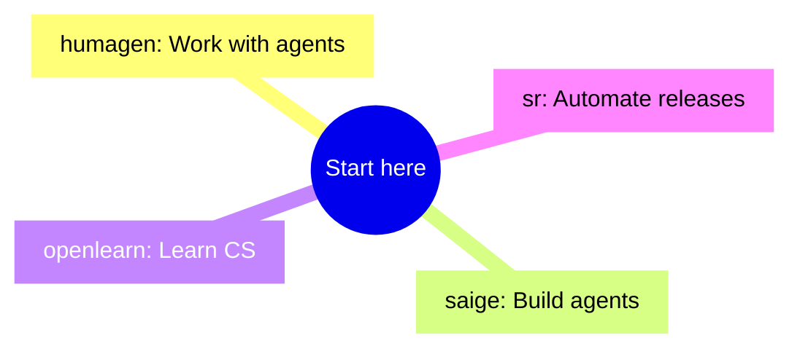

  <samp><a href="https://urmzd.com">website</a> · <a href="https://x.com/urmzd_">x</a> · <a href="https://linkedin.com/in/urmzd">linkedin</a></samp>

I build and use open-source tools that help people learn, create, and work with AI.

### Find your starting point

### Projects

- **[humagen](https://github.com/urmzd/humagen)**: A shared workspace for people and AI agents
- **[saige](https://github.com/urmzd/saige)**: Agents, memory, retrieval, and evaluations in Go
- **[openlearn](https://github.com/urmzd/openlearn)**: A free, self-paced computer science curriculum
- **[sr](https://github.com/urmzd/sr)**: Release automation for open-source projects

[More projects](https://github.com/urmzd?tab=repositories)
