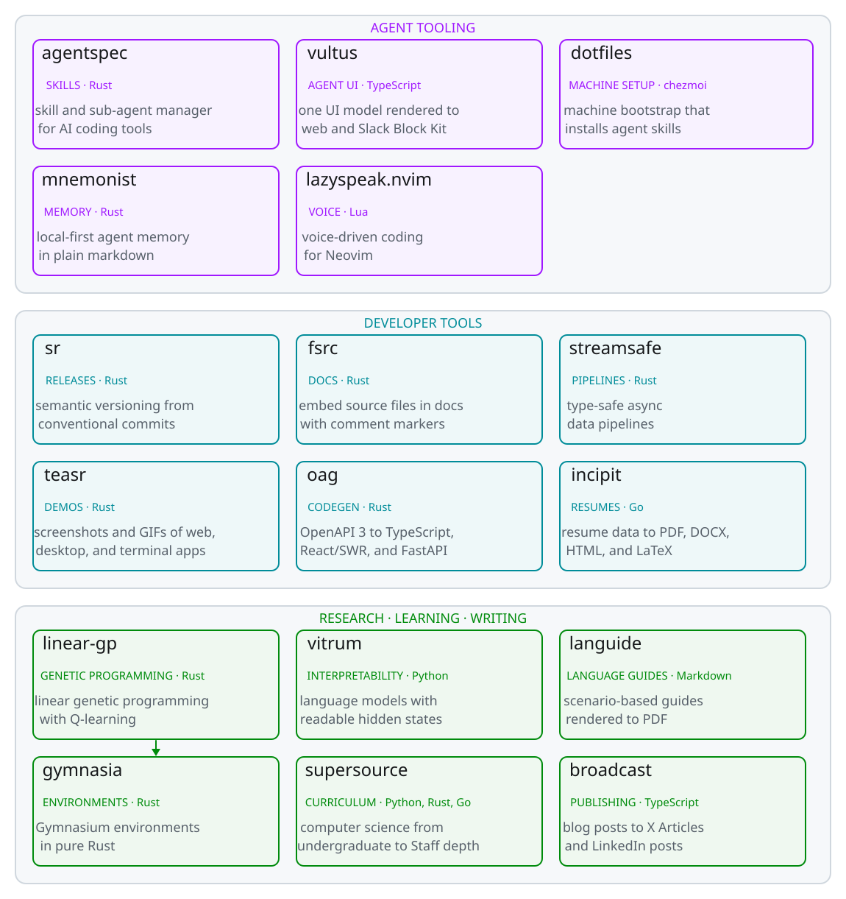

# Urmzd Mukhammadnaim

**Open-source tools for agents, developers, and learning.** I build agent infrastructure in Go, developer tools in Rust, and resources for learning computer science. Pick a project below to explore the code and get started.

  

## Start here

| Project | What you can do |
|---|---|
| **[saige](https://github.com/urmzd/saige)** | Build agents with knowledge graphs and retrieval using a Go SDK, CLI, or MCP server. |
| **[duraturo](https://github.com/urmzd/duraturo)** | Add durable execution and crash recovery to existing Go functions. |
| **[openlearn](https://github.com/urmzd/openlearn)** | Study computer science at your own pace, from foundations to advanced topics. |

Explore a repository for setup instructions, examples, and ways to contribute.

## Working on now

| Project | What you can do | Commits, 30 days |
|---|---|---|
| **[openlearn](https://github.com/urmzd/openlearn)** | Free, self-paced computer science curriculum, from foundations to advanced topics | 131 |
| **[saige](https://github.com/urmzd/saige)** | Build agents with knowledge graphs and retrieval using a Go SDK, CLI, or MCP server | 65 |
| **[mandatum](https://github.com/urmzd/mandatum)** | Trigger agents from your tools and route their events through a shared pub/sub bus | 45 |
| **[collegium](https://github.com/urmzd/collegium)** | Self-host sandboxed agents with shared messaging, governance, and human approvals | 25 |
| **[vultus](https://github.com/urmzd/vultus)** | Build agent interfaces for the web and Slack from the same React components | 22 |

## Agent stack

Solid arrows are Go module dependencies. Dashed boxes are external systems.

<picture>
  <source media="(prefers-color-scheme: dark)" srcset="assets/stack-dark.svg">
  
</picture>

## Other projects

Projects outside the agent stack, grouped by area.

<picture>
  <source media="(prefers-color-scheme: dark)" srcset="assets/map-dark.svg">
  
</picture>

17 more projects

| Project | What it is | Language | Stars |
|---|---|---|---|
| [dotfiles](https://github.com/urmzd/dotfiles) | Cross-platform dotfiles managed by Chezmoi with Homebrew/apt and per-language version managers | Rust | 4 |
| [urmzd.com](https://github.com/urmzd/urmzd.com) | Personal website, blog, and research portfolio built with Astro, React, and Three.js | TypeScript | 1 |
| [mnemonist](https://github.com/urmzd/mnemonist) | Give AI agents local memory through a Rust CLI and plain Markdown files | Rust | 4 |
| [agentspec](https://github.com/urmzd/agentspec) | Universal agent skill and sub-agent manager with TUI | Rust | 3 |
| [oag](https://github.com/urmzd/oag) | OpenAPI 3.x code generator for TypeScript, React/SWR, and FastAPI | Rust | 1 |
| [teasr](https://github.com/urmzd/teasr) | Capture showcase screenshots and GIFs from web apps, desktop, and terminal | Rust | 2 |
| [incipit](https://github.com/urmzd/incipit) | Here begins the new career | Go | 12 |
| [legatus](https://github.com/urmzd/legatus) | Beta control plane for agent execution nodes: deploy one service, scale sandboxed agents with metrics on a shared workspace | Go |  |
| [sr](https://github.com/urmzd/sr) | Release engineering CLI: single static binary, zero runtime dependencies, fully configurable | Rust |  |
| [lazyspeak.nvim](https://github.com/urmzd/lazyspeak.nvim) | Voice-driven coding for Neovim | Lua | 1 |
| [gymnasia](https://github.com/urmzd/gymnasia) | OpenAI Gymnasium environments in pure Rust | Rust | 2 |
| [duraturo](https://github.com/urmzd/duraturo) | Durable execution for existing Go code: wrap your functions, run a worker, done | Go | 1 |
| [fsrc](https://github.com/urmzd/fsrc) | Embed source files into any text file using comment markers | Rust | 1 |
| [streamsafe](https://github.com/urmzd/streamsafe) | Type-safe async pipeline framework for data processing in Rust | Rust |  |
| [linear-gp](https://github.com/urmzd/linear-gp) | Explore Linear Genetic Programming in Rust, with modular components and Q-Learning integration | Rust | 2 |
| [vitrum](https://github.com/urmzd/vitrum) | Observable language models: every hidden state is a readable distribution over words (hidden dim = vocab size) | Python |  |
| [broadcast](https://github.com/urmzd/broadcast) | Turn a blog post into platform-native content (X Articles, LinkedIn posts) from one CLI | TypeScript |  |

