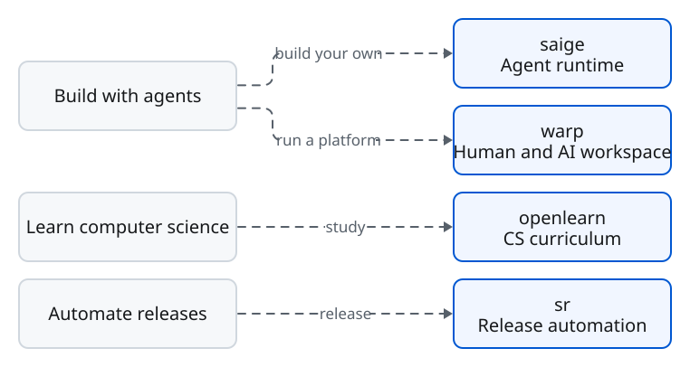
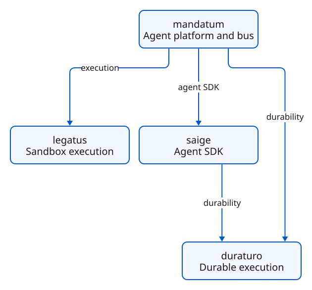
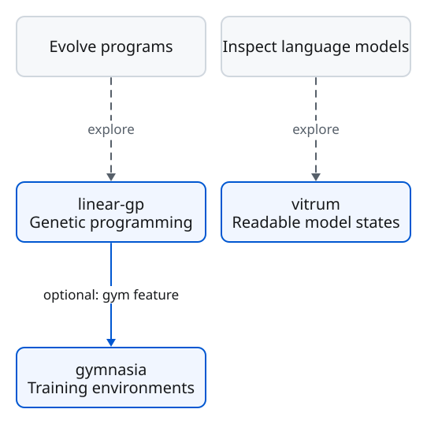

# Urmzd Mukhammadnaim

Enabling the next generation of productivity through collaboration between humans and AI.

I build open-source tools for myself, use them in my daily work, and share them so others can run, adapt, and serve them inside their own organizations. My goal is to help people learn, create, and become the best version of themselves.

  

## How I build

- **Dogfood everything**. I use what I build and let real needs shape the work.
- **Keep ownership with the user**. Tools should be useful to individuals and deployable inside the teams that rely on them.
- **Build with people in the loop**. AI should extend human ability, with shared knowledge, clear policies, and room for judgment.

## What I’m building toward

| Project | What you can do |
|---|---|
| **[warp](https://github.com/urmzd/warp)** | A shared workspace for humans and agents to coordinate projects, tasks, and knowledge under explicit policies |
| **[saige](https://github.com/urmzd/saige)** | Build AI tools with agents, memory, retrieval, and evaluations using a Go SDK, CLI, or MCP server |
| **[openlearn](https://github.com/urmzd/openlearn)** | Develop your abilities through a free, self-paced computer science curriculum |
| **[sr](https://github.com/urmzd/sr)** | Automate release work so you can spend more time building useful things |

Explore a repository for setup instructions, examples, and ways to contribute.

How the tools and research fit together

## Find your starting point

Choose the task you want to tackle. Dashed arrows suggest where to start.

<picture>
  <source media="(prefers-color-scheme: dark)" srcset="assets/finder-dark.svg">
  
</picture>

[saige](https://github.com/urmzd/saige) · [warp](https://github.com/urmzd/warp) · [openlearn](https://github.com/urmzd/openlearn) · [sr](https://github.com/urmzd/sr)

## Inside the agent stack

Warp brings the agent runtime, connective infrastructure, governed workspaces, and durability together. Solid arrows point from a project to a dependency.

<picture>
  <source media="(prefers-color-scheme: dark)" srcset="assets/stack-dark.svg">
  
</picture>

[warp](https://github.com/urmzd/warp) · [fiber](https://github.com/urmzd/fiber) · [playscape](https://github.com/urmzd/playscape) · [saige](https://github.com/urmzd/saige) · [anchor](https://github.com/urmzd/anchor)

Dependency sources: [fiber/go.mod](https://github.com/urmzd/fiber/blob/HEAD/go.mod), [saige/go.mod](https://github.com/urmzd/saige/blob/HEAD/go.mod), [warp/go.mod](https://github.com/urmzd/warp/blob/HEAD/go.mod).

## Explore the research

Two research directions, with one optional environment dependency. Dashed arrows suggest where to start. Solid arrows point from a project to a dependency.

<picture>
  <source media="(prefers-color-scheme: dark)" srcset="assets/research-dark.svg">
  
</picture>

[linear-gp](https://github.com/urmzd/linear-gp) · [gymnasia](https://github.com/urmzd/gymnasia) · [vitrum](https://github.com/urmzd/vitrum)

Dependency sources: [linear-gp/crates/lgp/Cargo.toml](https://github.com/urmzd/linear-gp/blob/HEAD/crates/lgp/Cargo.toml).

18 more projects

| Project | What it is | Language | Stars |
|---|---|---|---|
| [dotfiles](https://github.com/urmzd/dotfiles) | Cross-platform dotfiles managed by Chezmoi with Homebrew/apt and per-language version managers | Shell | 5 |
| [fiber](https://github.com/urmzd/fiber) | Connect tools and agents through shared messaging and extensible integrations | Go |  |
| [urmzd.com](https://github.com/urmzd/urmzd.com) | Personal website, blog, and research portfolio built with Astro, React, and Three.js | TypeScript | 1 |
| [playscape](https://github.com/urmzd/playscape) | Governed execution environments for agents: isolated workspaces, scoped capabilities and default-deny access policies | Go |  |
| [mnemonist](https://github.com/urmzd/mnemonist) | Give AI agents local memory through a Rust CLI and plain Markdown files | Rust | 4 |
| [agentspec](https://github.com/urmzd/agentspec) | Universal agent skill and sub-agent manager with TUI | Rust | 3 |
| [oag](https://github.com/urmzd/oag) | OpenAPI 3.x code generator for TypeScript, React/SWR, and FastAPI | Rust | 1 |
| [incipit](https://github.com/urmzd/incipit) | Here begins the new career | Go | 12 |
| [teasr](https://github.com/urmzd/teasr) | Capture showcase screenshots and GIFs from web apps, desktop, and terminal | Rust | 2 |
| [anchor](https://github.com/urmzd/anchor) | Durable execution for Go: replayable workflows, checkpoints and recovery over ledgers and queues backed by storage you own | Go | 1 |
| [lazyspeak.nvim](https://github.com/urmzd/lazyspeak.nvim) | Voice-driven coding for Neovim | Lua | 1 |
| [gymnasia](https://github.com/urmzd/gymnasia) | OpenAI Gymnasium environments in pure Rust | Rust | 2 |
| [fsrc](https://github.com/urmzd/fsrc) | Embed source files into any text file using comment markers | Rust | 1 |
| [streamsafe](https://github.com/urmzd/streamsafe) | Type-safe async pipeline framework for data processing in Rust | Rust |  |
| [linear-gp](https://github.com/urmzd/linear-gp) | Explore Linear Genetic Programming in Rust, with modular components and Q-Learning integration | Rust | 2 |
| [rlgp-thesis](https://github.com/urmzd/rlgp-thesis) | BCS Thesis: Reinforced Linear Genetic Programming | TeX |  |
| [vitrum](https://github.com/urmzd/vitrum) | Observable language models: every hidden state is a readable distribution over words (hidden dim = vocab size) | Python |  |
| [broadcast](https://github.com/urmzd/broadcast) | Turn a blog post into platform-native content (X Articles, LinkedIn posts) from one CLI | TypeScript |  |

