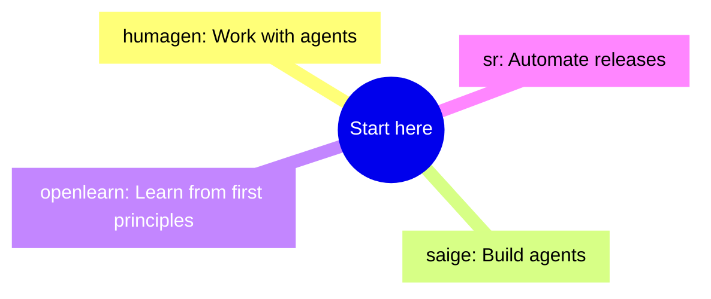

  <samp><a href="https://urmzd.com">website</a> · <a href="https://x.com/urmzd_">x</a> · <a href="https://linkedin.com/in/urmzd">linkedin</a></samp>

I build and use open-source tools that help people learn, create, and work with AI.

### Find your starting point

### Projects

- **[humagen](https://github.com/urmzd/humagen)**: A self-hosted workspace where people and AI agents share projects, knowledge, and rules
- **[saige](https://github.com/urmzd/saige)**: A Go SDK, CLI, and MCP server to build, ground, and evaluate AI agents
- **[openlearn](https://github.com/urmzd/openlearn)**: Free technical books on mathematics, AI, systems, and software, with worked solutions
- **[sr](https://github.com/urmzd/sr)**: Version, changelog, and publish releases from conventional commits

[More projects](https://github.com/urmzd?tab=repositories)
